<h1 align="center">INPX Library Server</h1>

<p align="center">
  Домашняя библиотека электронных книг для коллекций INPX / FB2:<br>
  каталог и поиск, чтение в браузере, OPDS, отправка на ридер и <a href="https://github.com/Habsaec/inpx-book-reader">Android-приложение</a>.
</p>

<p align="center">
  <a href="https://github.com/Habsaec/inpx-library-server/releases/latest"></a>
  <a href="https://hub.docker.com/r/habsaec/inpx-library-server"></a>
  
  
  <a href="LICENSE"></a>
</p>

<p align="center">
  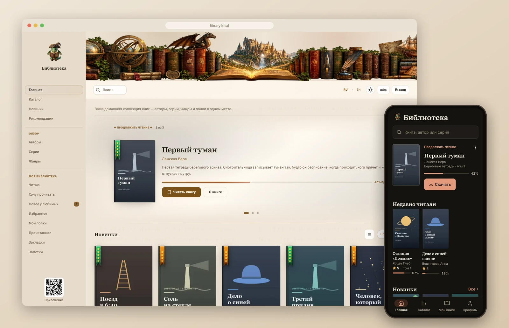
</p>

<p align="center">
  <a href="#установка">Установка</a> ·
  <a href="#первые-шаги">Первые шаги</a> ·
  <a href="#возможности">Возможности</a> ·
  <a href="#android-приложение">Android</a> ·
  <a href="#opds-и-koreader">OPDS и KOReader</a> ·
  <a href="#настройка">Настройка</a> ·
  <a href="CHANGELOG.md">Изменения</a> ·
  <a href="https://boosty.to/habsaec/donate">Поддержать проект</a>
</p>

Укажите папку с архивами Флибусты, Либрусека или своими FB2 / EPUB — сервер построит каталог с авторами, сериями, жанрами и полнотекстовым поиском. Читать можно прямо в браузере или в Android-приложении: позиция, закладки и заметки синхронизируются. Работает на NAS, Raspberry Pi и обычном ПК, рассчитан на библиотеки в сотни тысяч книг.

## Как это выглядит

<table>
  <tr>
    <td width="50%"></td>
    <td width="50%">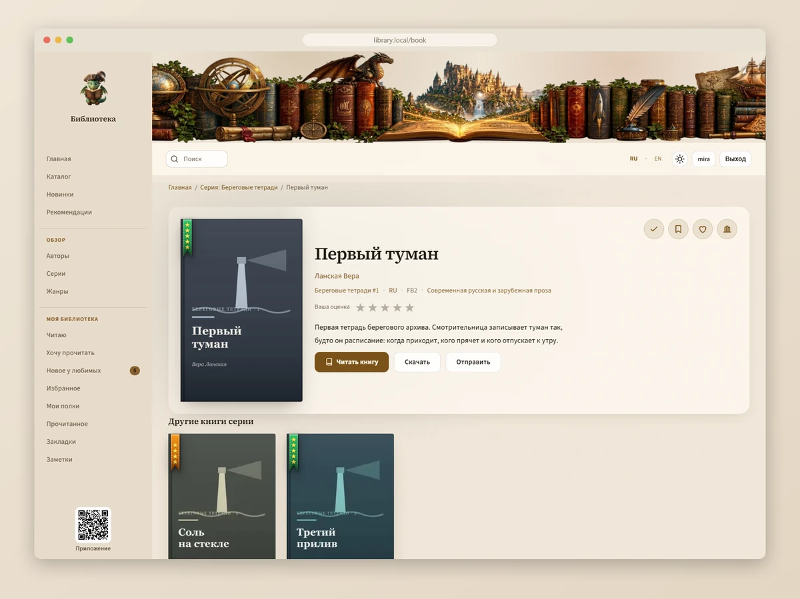</td>
  </tr>
  <tr>
    <td align="center"><b>Каталог</b> — обложки или список, фильтры, сортировка</td>
    <td align="center"><b>Книга</b> — серия, оценка, скачивание, отправка на ридер</td>
  </tr>
  <tr>
    <td>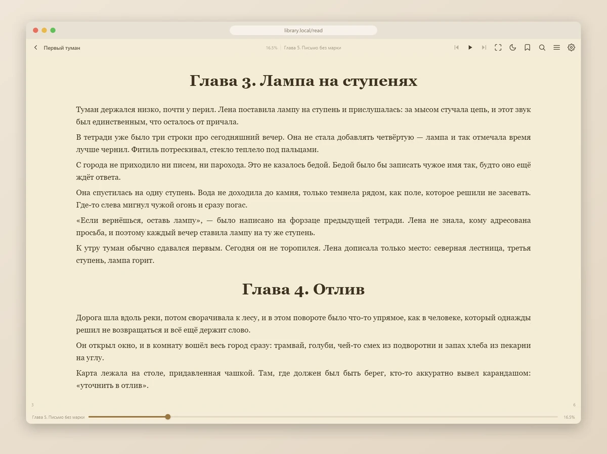</td>
    <td>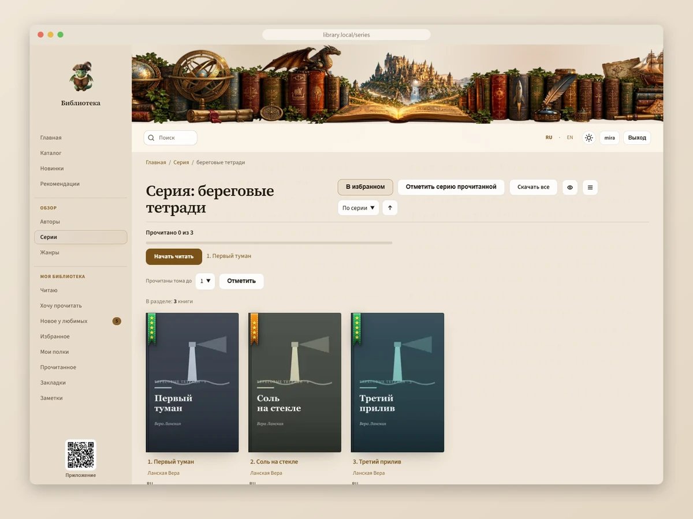</td>
  </tr>
  <tr>
    <td align="center"><b>Читалка</b> — FB2 / EPUB в браузере, темы, закладки, озвучка</td>
    <td align="center"><b>Серия</b> — «Прочитано N из M» и следующий том</td>
  </tr>
</table>

<p align="center">
  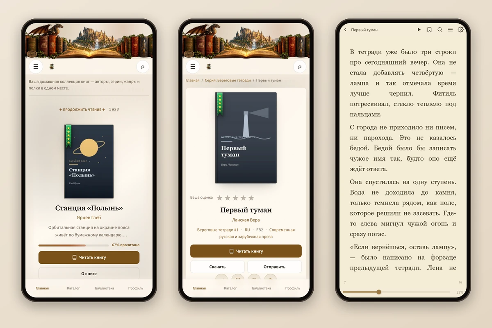
</p>

<details>
<summary><b>Ещё скриншоты</b>: поиск, профиль, полки, тёмная тема, админка</summary>
<br>

| | |
|---|---|
| 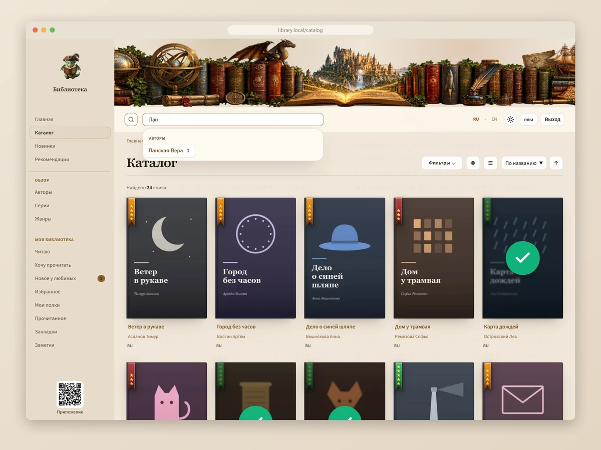 | 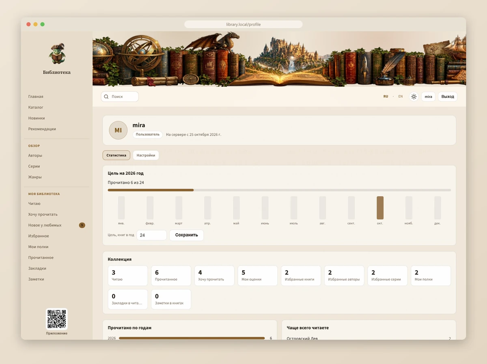 |
| Подсказки поиска: книги, авторы, серии | Профиль: цель на год, статистика, коллекция |
| 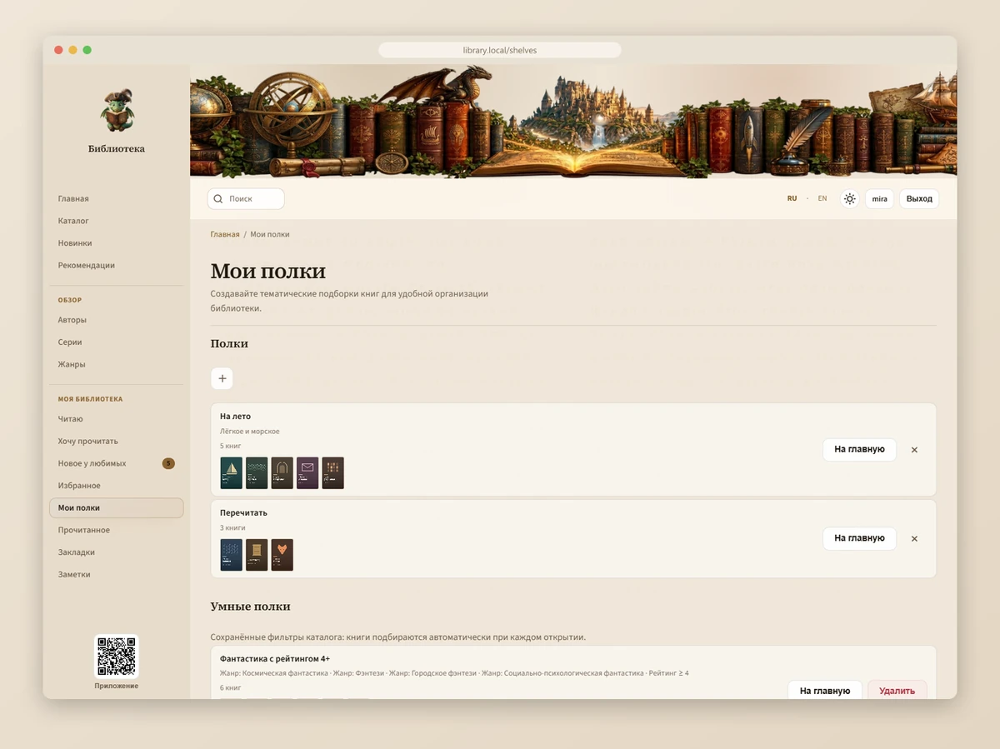 | 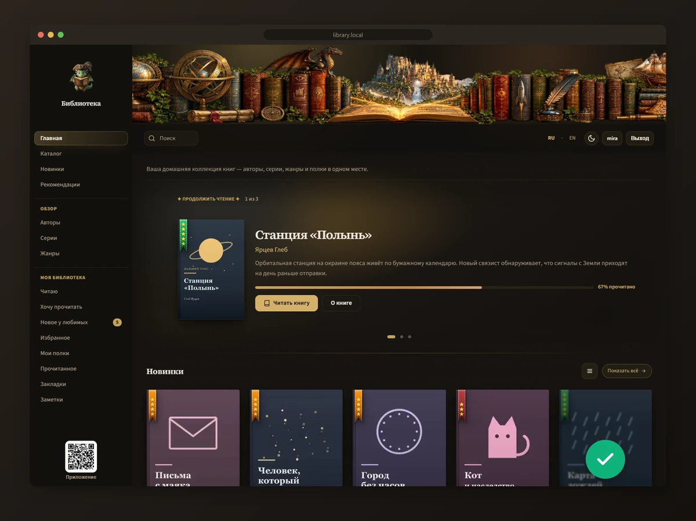 |
| Полки и умные полки | Тёмная тема |
| 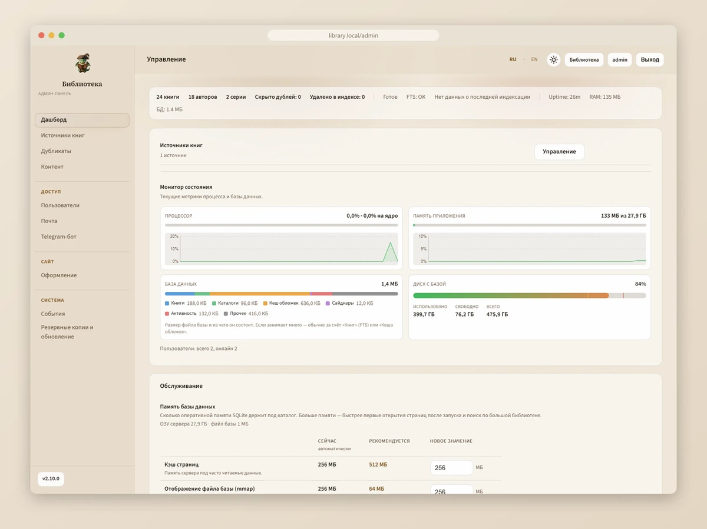 | 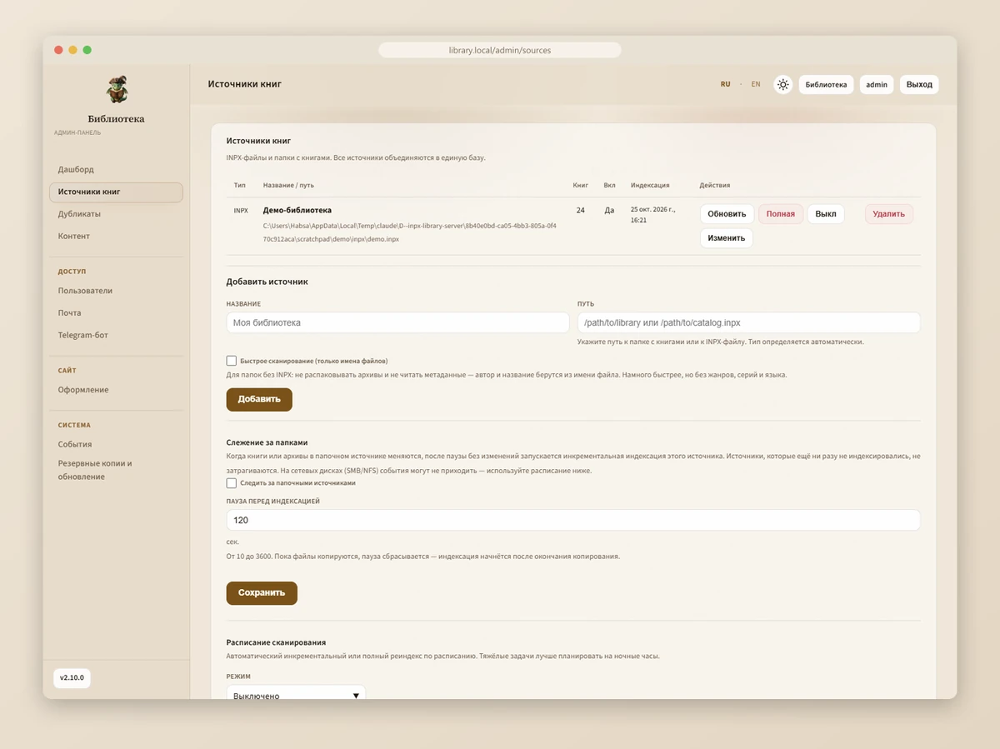 |
| Админка: состояние сервера и память базы | Админка: источники книг и слежение за папками |

На скриншотах — вымышленная демо-библиотека.
</details>

## Установка

Нужна папка с книгами: INPX-коллекция (`.inpx` + архивы `.zip` / `.7z`) или обычный каталог с FB2 / EPUB / MOBI / AZW3.

### Docker

```bash
docker run -d \
  --name inpx-library \
  --restart unless-stopped \
  -p 3000:3000 \
  -v inpx-app:/app \
  -v inpx-data:/app/data \
  -v /path/to/library:/library:ro \
  -e LIBRARY_ROOT=/library \
  habsaec/inpx-library-server:latest
```

Откройте http://localhost:3000 и войдите как **admin / admin**.

- `inpx-data` — база, настройки и кэш. Её и нужно бэкапить.
- `inpx-app` — код приложения. При запуске нового образа код в томе обновляется сам.
- Другие папки с книгами монтируйте в `/sources/…` (`-v /path/to/epub:/sources/epub:ro`) и добавляйте в админке как источник.

Обновление: `docker pull habsaec/inpx-library-server:latest`, затем пересоздайте контейнер той же командой.

<details>
<summary><b>Docker Compose</b></summary>

```yaml
services:
  library:
    image: habsaec/inpx-library-server:latest
    container_name: inpx-library
    restart: unless-stopped
    ports:
      - "3000:3000"
    volumes:
      - app-code:/app
      - app-data:/app/data
      - /path/to/library:/library:ro
    environment:
      - LIBRARY_ROOT=/library

volumes:
  app-code:
  app-data:
```

```bash
docker compose up -d
```

`docker compose down -v` удаляет и тома с данными — не используйте `-v`, если библиотека нужна.
</details>

<details>
<summary><b>Synology NAS (Container Manager)</b></summary>

В репозитории есть готовый [`docker-compose.yml`](docker-compose.yml) для Synology: порт **3000**, данные — в `/volume1/docker/inpx-library-data`.

1. Создайте папку данных: `mkdir -p /volume1/docker/inpx-library-data`.
2. В `docker-compose.yml` раскомментируйте строку с томом книг и укажите свой путь, например `- /volume1/books/library:/library:ro`.
3. **Container Manager → Проект → Создать**, выберите папку с `docker-compose.yml` → **Применить**.
4. Откройте `http://<IP-NAS>:3000` → **admin / admin**.

Образ собран для **amd64** и **arm64**.
</details>

### Windows

1. Скачайте `inpx-library-server-<версия>.zip` из [последнего релиза](https://github.com/Habsaec/inpx-library-server/releases/latest) и распакуйте, например, в `D:\inpx-library-server`.
2. Запустите **`install.cmd`**. Он скачает портативный Node.js 24 в папку `runtime`, установит зависимости и конвертер fb2cng. Системный Node.js не нужен.
3. Запустите **`start-server.cmd`** и откройте http://localhost:3000.

Остановка — `stop-server.cmd`, перезапуск — `restart-server.cmd`. Путь к книгам удобнее всего указать в админке при добавлении источника.

### Linux (Debian / Ubuntu / Raspberry Pi OS / OpenMediaVault)

```bash
git clone https://github.com/Habsaec/inpx-library-server.git
cd inpx-library-server
sudo ./install.sh    # Node.js 20, зависимости, конвертер; предложит службу systemd
./start.sh
```

Если при установке вы включили службу:

```bash
sudo systemctl status inpx-library
sudo journalctl -u inpx-library -f
```

### macOS

Нужны Xcode Command Line Tools и Node.js 20+ (Homebrew или установщик с nodejs.org).

```bash
git clone https://github.com/Habsaec/inpx-library-server.git
cd inpx-library-server
sudo ./install.sh
./start.sh
```

## Первые шаги

1. Войдите как **admin / admin** и сразу смените пароль в профиле.
2. **Админка → Источники книг → «Добавить источник»**: путь к файлу `.inpx` или к папке с книгами (для Docker — путь внутри контейнера, например `/library`).
3. Дождитесь индексации. Ход виден в админке; полная Флибуста индексируется около 45 минут.
4. Создайте пользователей в **Админка → Пользователи** или включите там же «Анонимный доступ».
5. Для отправки книг на ридер заполните **Админка → Почта**, для Telegram — **Админка → Telegram-бот**.
6. Резервная копия: **Админка → Резервные копии и обновление → «Скачать бэкап БД»** (или файл `data/library.db`).

За HTTPS / reverse proxy (nginx, Caddy, Traefik) задайте `TRUST_PROXY=1` и `SESSION_SECURE_COOKIE=true`.

## Возможности

| | |
|---|---|
| **Каталог и поиск** | Полнотекстовый поиск с подсказками и исправлением опечаток · авторы, серии, жанры, языки · фильтры (жанр И/ИЛИ, язык, формат, год, рейтинг) · новинки, рекомендации, похожие книги |
| **Чтение** | FB2 и EPUB в браузере: темы, шрифты, закладки, заметки с цветами, озвучка · позиция синхронизируется с телефоном без «прыжков» · экспорт заметок в Markdown / HTML |
| **Личная библиотека** | Читаю · Хочу прочитать · Прочитано · Мои оценки · избранные авторы и серии · «Новое у любимых» · полки и умные полки · цель на год и статистика · импорт из Goodreads / LiveLib |
| **Выдача** | FB2, FB2.ZIP, EPUB, MOBI, AZW3 и др. через [fb2cng](https://github.com/rupor-github/fb2cng) · пакетный ZIP · отправка на e-mail ридера (Kindle, PocketBook, Kobo) и в Telegram |
| **Клиенты** | Android-приложение · OPDS 1.x / 2 с прогрессом чтения · синхронизация прогресса KOReader (KOSync) · Telegram-бот с поиском |
| **Источники** | INPX-коллекции (ZIP / 7z, включая PPMd) и обычные папки · несколько источников сразу · чистка дубликатов · слежение за папками · обложки, иллюстрации (JPEG XL, WebP), рецензии и портреты из sidecar Флибусты |
| **Админка** | Пользователи и права, анонимный доступ, OIDC / SSO · SMTP и Telegram · оформление (логотип, шапка, фон, палитра) · мониторинг, журнал, бэкап, обновление из ZIP |

Интерфейс на русском и английском, светлая, тёмная и автоматическая тема. Пересоздание индекса и удаление источника не теряют закладки, позиции и полки пользователей.

## Android-приложение

[**INPX Book Reader**](https://github.com/Habsaec/inpx-book-reader) — читалка для Android, работающая с этим сервером: каталог, офлайн-чтение, озвучка, режим E-Ink и общая с веб-читалкой синхронизация.

1. Установите APK из [релизов приложения](https://github.com/Habsaec/inpx-book-reader/releases/latest) — ссылка и QR-код есть в боковой панели веб-интерфейса («Приложение»).
2. Там же откройте окно входа: сервер покажет одноразовый QR-код (действует 10 минут). Отсканируйте его в приложении — адрес, логин и пароль вводить не придётся.

## OPDS и KOReader

**OPDS** — `http://<сервер>:3000/opds` (OPDS 2: `/opds/v2`). Вход — логин и пароль пользователя библиотеки. Подходит для KOReader, FBReader, Moon+ Reader, Librera. У начатых книг в названии виден прогресс: ◔ ◑ ◕ ⬤.

**Синхронизация прогресса KOReader:**

1. В профиле, в блоке **«KOReader: синхронизация прогресса»**, создайте отдельный пароль для KOReader (пароль аккаунта не используется).
2. В KOReader: **Облако → Синхронизация прогресса → Свой сервер**, адрес `http://<сервер>:3000/kosync`, ваш логин и созданный пароль.
3. Скачайте книгу через OPDS — так сервер узнаёт её в KOReader.

## Как устроено

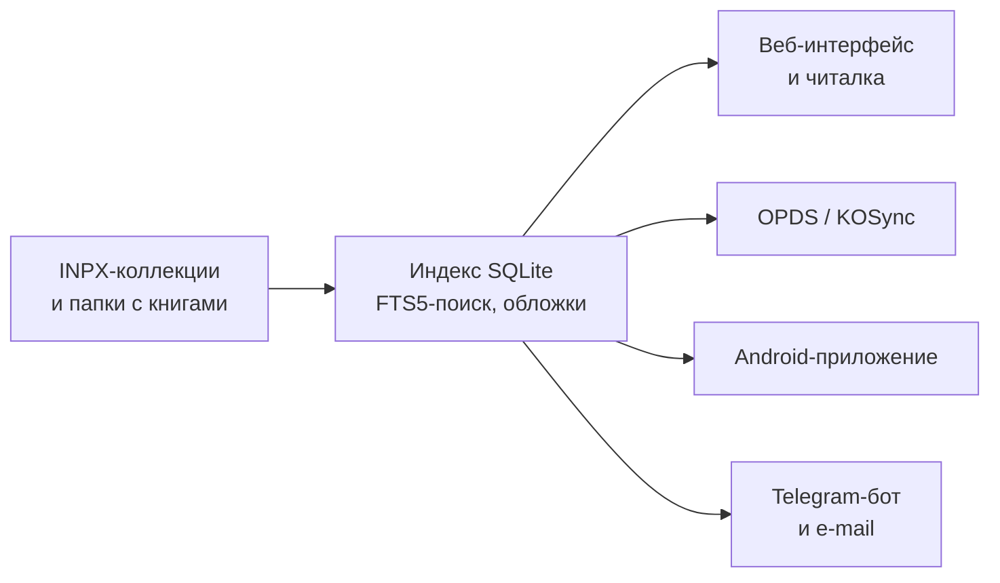

Метаданные (серии, авторы, жанры) берутся из индекса и отдаются через `/api/*` — один контракт для веба, OPDS, Telegram и Android.

## Настройка

Почти всё настраивается в админке. Переменные окружения задают значения по умолчанию; полный список с комментариями — в [`.env.example`](.env.example) (скопируйте в `.env`).

<details>
<summary><b>Основные переменные окружения</b></summary>

| Переменная | По умолчанию | Описание |
|---|---|---|
| `PORT` | `3000` | Порт сервера |
| `LIBRARY_ROOT` | `/library` | Папка с книгами по умолчанию |
| `SESSION_SECURE_COOKIE` | `false` | `true` за HTTPS |
| `TRUST_PROXY` | `false` | Прокси перед сервером: `1` — один nginx / Caddy, `loopback` или список подсетей |
| `SMTP_HOST`, `SMTP_PORT`, `SMTP_USER`, `SMTP_PASS`, `SMTP_FROM` | — | Почта для отправки на ридер (или в админке) |
| `TELEGRAM_BOT_TOKEN` | — | Токен Telegram-бота (или в админке) |
| `SCAN_INTERVAL_HOURS` | `0` | Пересканировать источники каждые N часов |
| `FOLDER_WATCH` | `1` | Следить за папками и индексировать новые файлы |
| `DOWNLOAD_MAX_CONCURRENT` | `4` | Сколько книг готовится к выдаче одновременно |
| `PERF_PROFILE` | авто | `embedded` для NAS / малой памяти |
| `CLUSTER_WORKERS` | `0` | Число процессов (0 — один) |

</details>

<details>
<summary><b>Большие библиотеки и слабое железо</b></summary>

- Индексация и тяжёлые пересчёты идут в фоновых потоках — сервер отвечает во время импорта.
- На устройствах с ≤ 2 ГБ памяти включается экономный профиль; кэш базы настраивается в **Админка → Дашборд → Обслуживание → Память базы данных**.
- Флибуста и Либрусек «96 ГБ» (PPMd-архивы, картинки WebP) поддерживаются. Для старых ридеров включите **Админка → Контент → «Иллюстрации WebP в FB2»** (перекодирование в PNG).
- Добавили вторую копию той же коллекции — запустите **Админка → Дубликаты → автоочистка**.

</details>

<details>
<summary><b>Если что-то не работает</b></summary>

- **Сервер не отвечает:** `curl -sS http://127.0.0.1:3000/health` должен вернуть `"ok":true`.
- **Каталог пуст:** источник добавлен и индексация завершилась? В Docker путь источника — внутри контейнера (`/library`, `/sources/…`).
- **«Архивы не найдены» после импорта INPX:** архивы `.zip` / `.7z` должны лежать рядом с `.inpx`; проверьте монтирование.
- **Нет EPUB / MOBI в «Скачать»:** конвертер не установлен — повторите `install.cmd` / `install.sh`.
- **Ошибка `better-sqlite3` / `NODE_MODULE_VERSION`:** повторно запустите `install.cmd` / `install.sh`.
- **Забыли пароль admin:** `reset-admin.cmd` (Windows) или `./reset-admin.sh`.
- **Сервер «подвисает»:** ищите `[perf] event loop stalled` в `data/runtime.log`, время ответов — на `/health/perf`.

</details>

## Для разработчиков

```bash
npm install
npm run dev      # перезапуск при изменениях
npm test
```

Node.js (ESM), Express, SQLite (better-sqlite3), vanilla JS / CSS без фреймворков. Документация: [`AGENTS.md`](AGENTS.md) (API для Android и правила проекта), [`docs/architecture`](docs/architecture) (индексация, INPX, поиск, OPDS), [`docs/decisions`](docs/decisions). Ошибки API содержат стабильное поле `code` — клиентам стоит опираться на него.

## Связанные проекты

| Репозиторий | |
|---|---|
| [inpx-library-server](https://github.com/Habsaec/inpx-library-server) | Сервер: индекс, веб, OPDS, API (этот репозиторий) |
| [inpx-book-reader](https://github.com/Habsaec/inpx-book-reader) | Android-приложение |

## Лицензия

[MIT](LICENSE)
