<h1 align="center">INPX Library Server</h1>

<p align="center">
  <b>English</b> · <a href="README.ru.md">Русский</a>
</p>

<p align="center">
  Self-hosted ebook library for INPX collections and plain book folders:<br>
  catalog and search, in-browser reader, OPDS, send to e-reader and an <a href="https://github.com/Habsaec/inpx-book-reader">Android app</a>.
</p>

<p align="center">
  <a href="https://github.com/Habsaec/inpx-library-server/releases/latest"></a>
  <a href="https://hub.docker.com/r/habsaec/inpx-library-server"></a>
  
  
  <a href="LICENSE"></a>
</p>

<p align="center">
  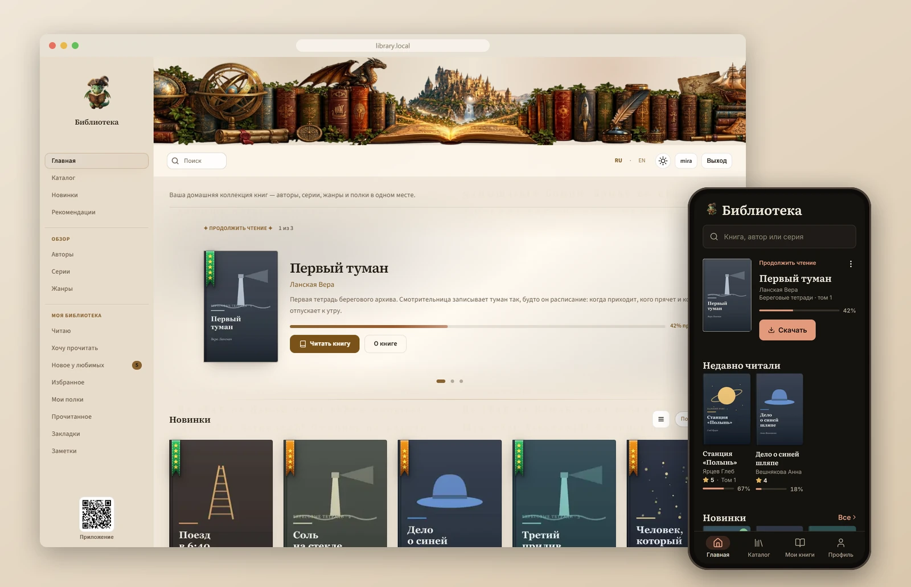
</p>

<p align="center">
  <a href="#installation">Installation</a> ·
  <a href="#getting-started">Getting started</a> ·
  <a href="#features">Features</a> ·
  <a href="#android-app">Android</a> ·
  <a href="#opds-and-koreader">OPDS and KOReader</a> ·
  <a href="#configuration">Configuration</a> ·
  <a href="CHANGELOG.md">Changelog</a> ·
  <a href="https://habsaec.github.io/inpx-library-server/">Website</a>
</p>

<p align="center">
  <a href="https://boosty.to/habsaec/donate"></a>
</p>

Point the server at a folder of books — an INPX collection (the format of large library dumps), a [Calibre library](#calibre-libraries) or your own FB2 / EPUB files — and it builds a catalog with authors, series, genres and full-text search. Read in the browser or in the Android app: reading position, bookmarks and notes stay in sync. Runs on a NAS, a Raspberry Pi or a regular PC and is built for libraries of hundreds of thousands of books.

## What it looks like

<table>
  <tr>
    <td width="50%"></td>
    <td width="50%">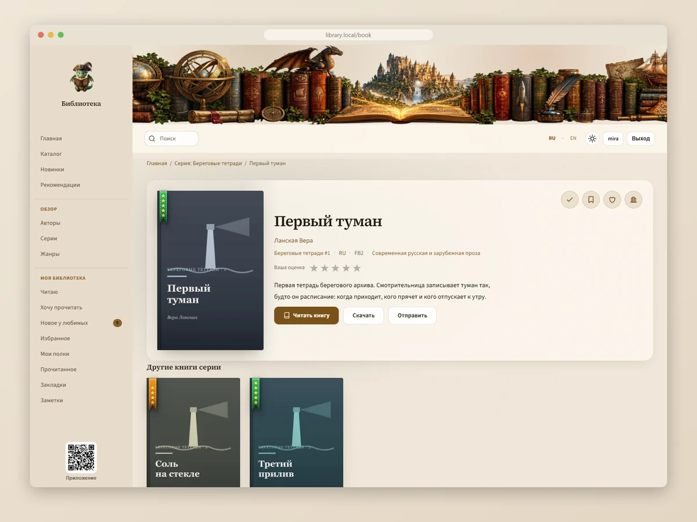</td>
  </tr>
  <tr>
    <td align="center"><b>Catalog</b> — covers or list, filters, sorting</td>
    <td align="center"><b>Book</b> — series, rating, download, send to e-reader</td>
  </tr>
  <tr>
    <td>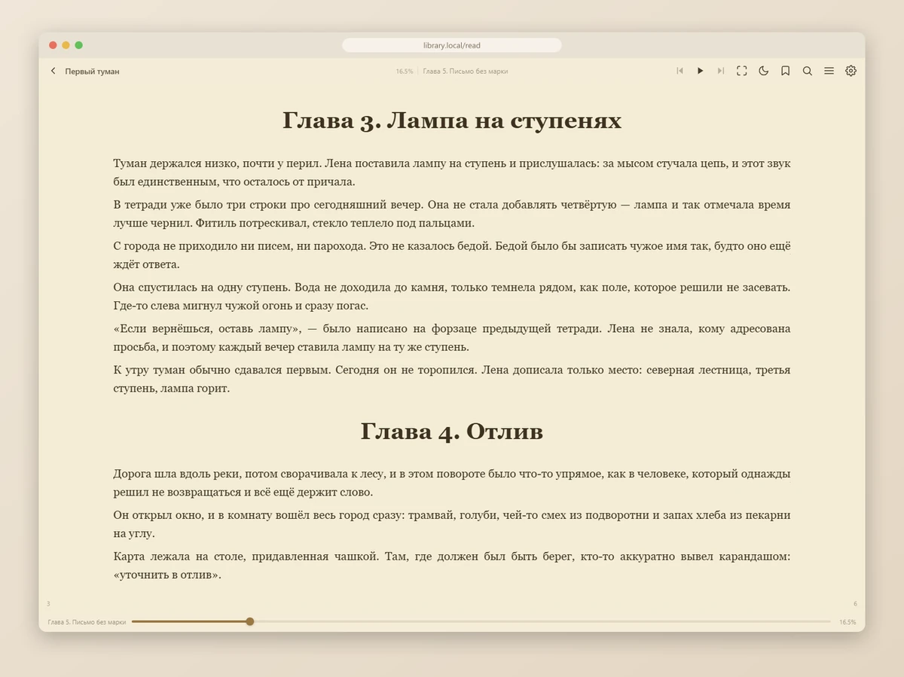</td>
    <td>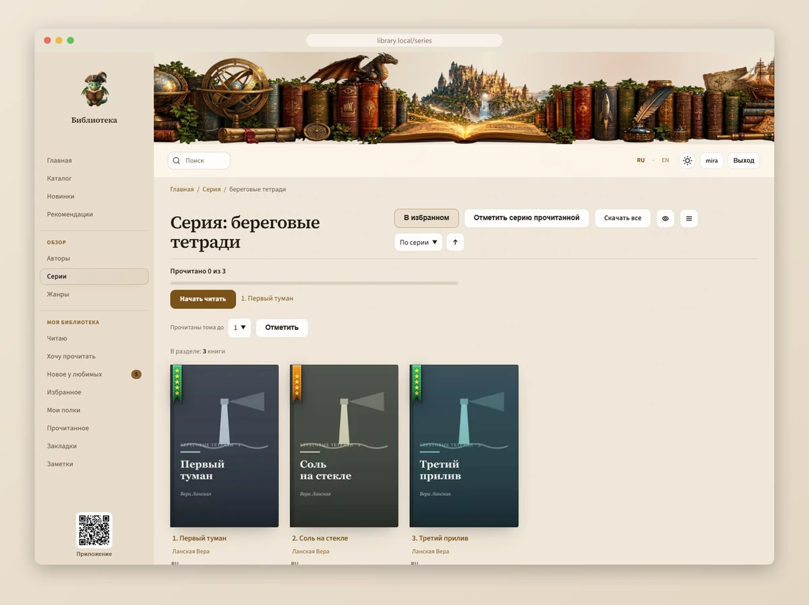</td>
  </tr>
  <tr>
    <td align="center"><b>Reader</b> — FB2 / EPUB in the browser, themes, bookmarks, read aloud</td>
    <td align="center"><b>Series</b> — «N of M read» and the next volume</td>
  </tr>
</table>

<p align="center">
  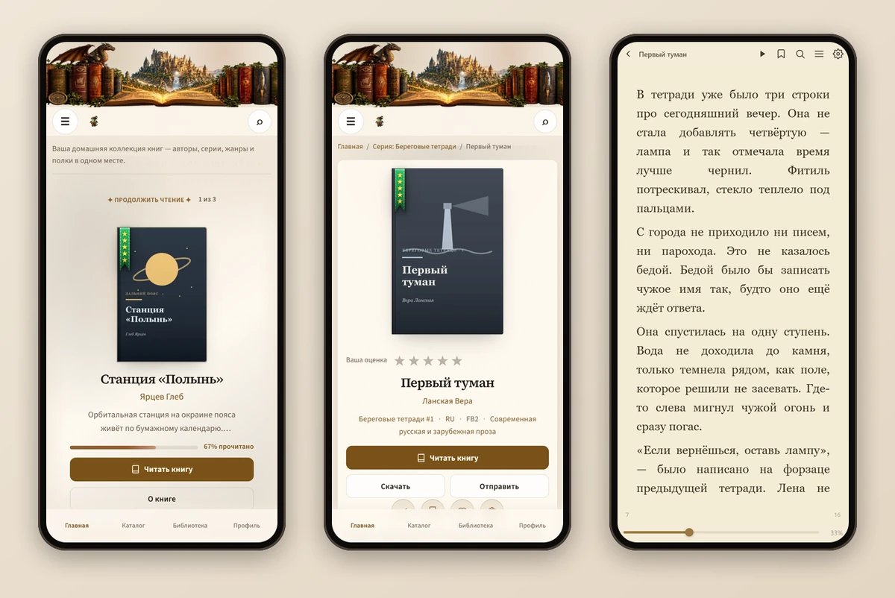
</p>

<details>
<summary><b>More screenshots</b>: search, profile, shelves, dark theme, admin</summary>
<br>

| | |
|---|---|
| 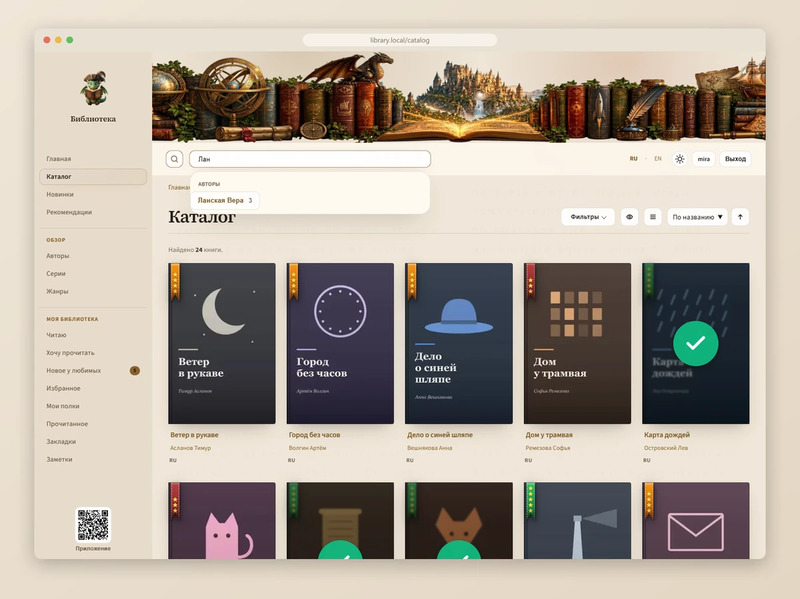 | 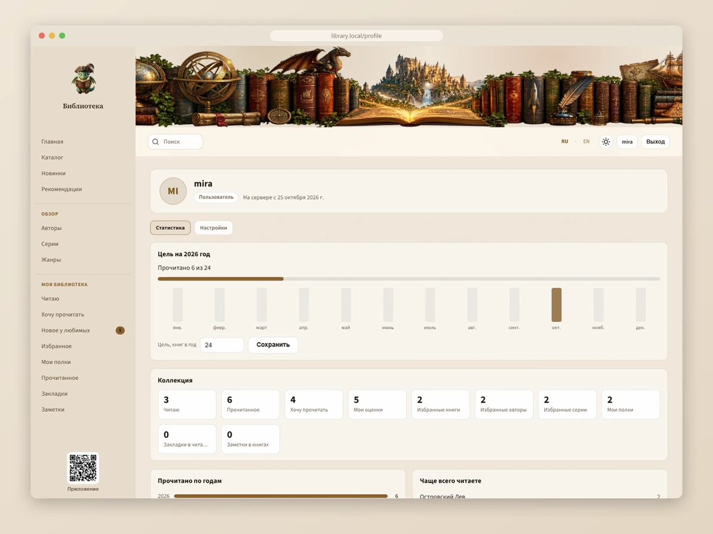 |
| Search suggestions: books, authors, series | Profile: yearly goal, stats, collection |
| 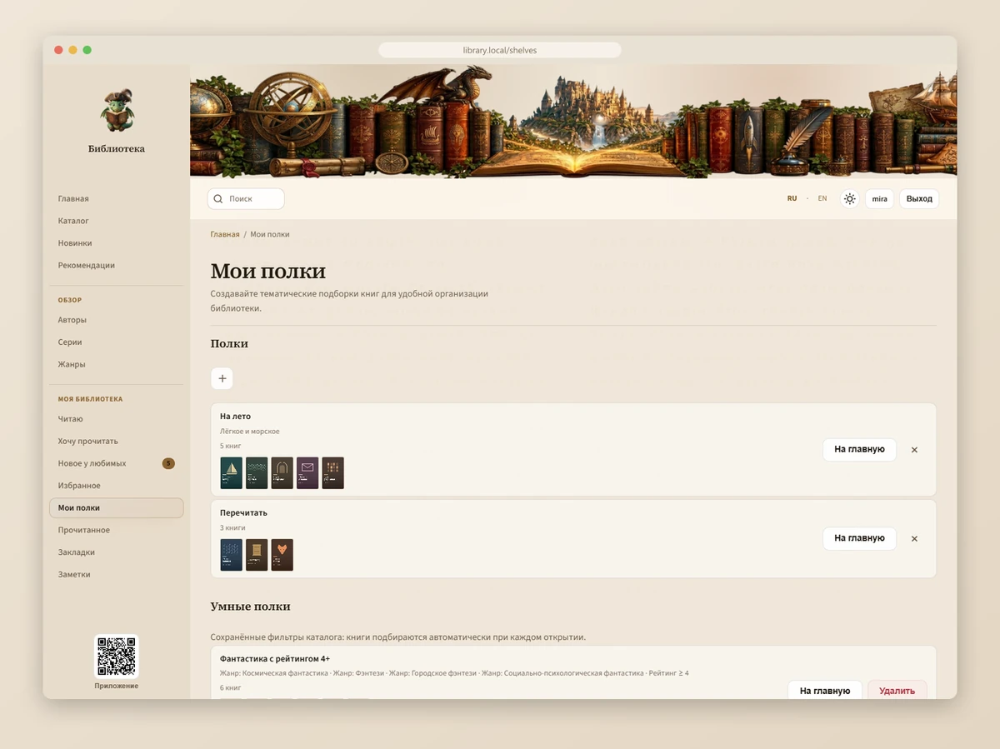 | 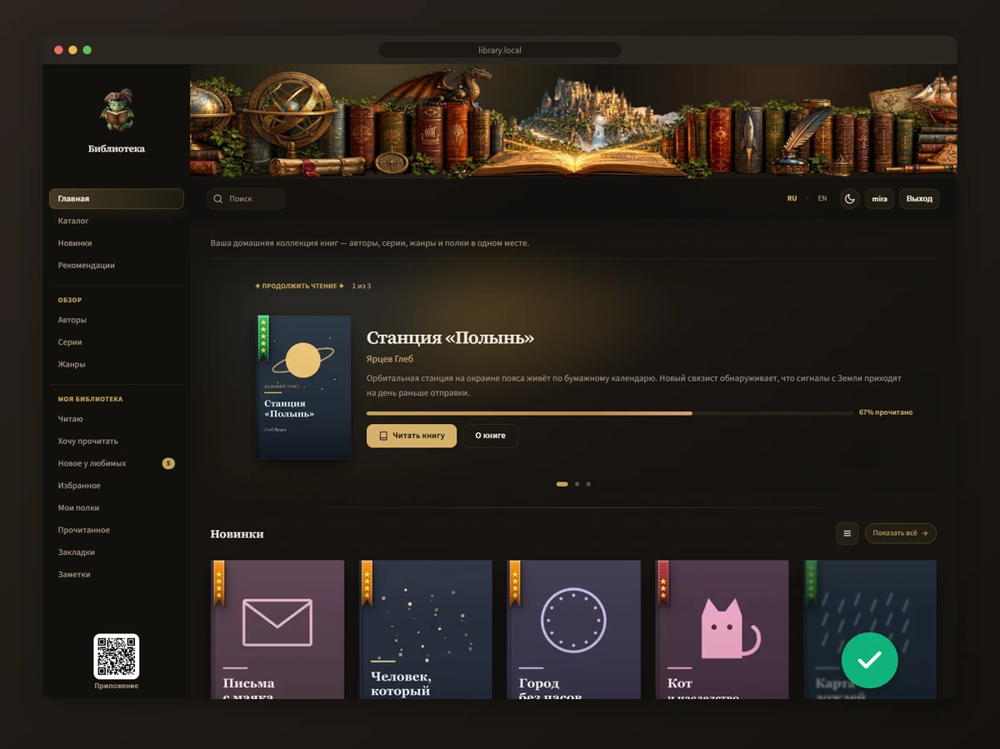 |
| Shelves and smart shelves | Dark theme |
| 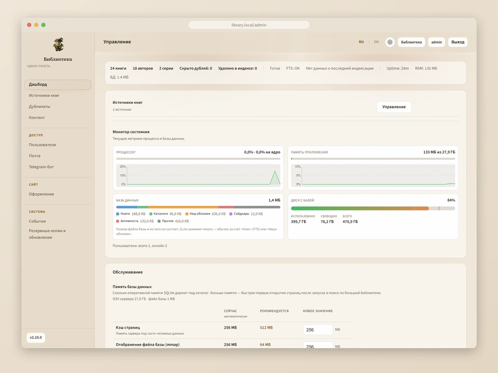 | 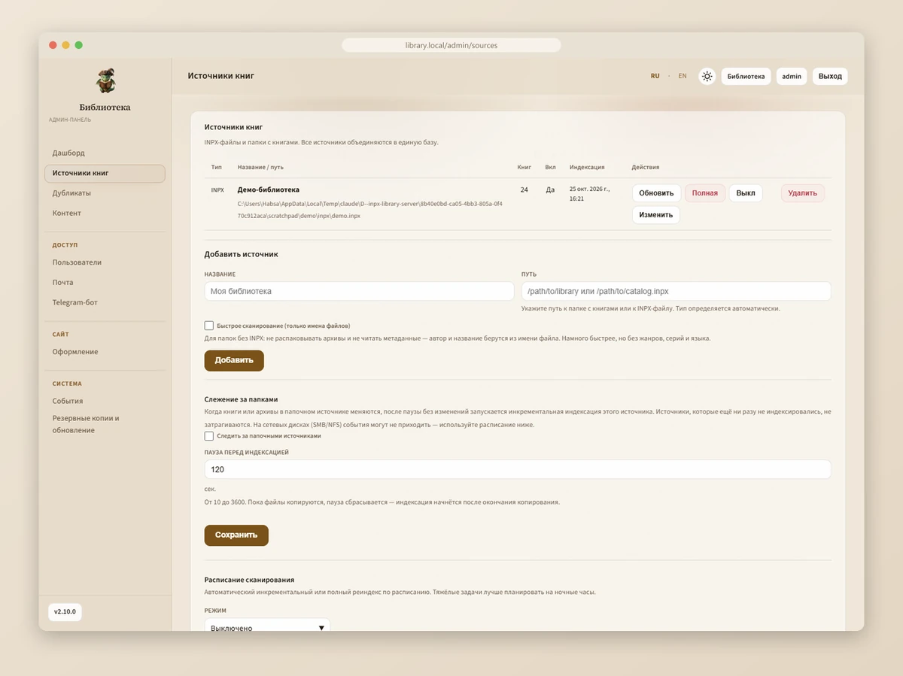 |
| Admin: server status and database memory | Admin: book sources and folder watching |

The screenshots show the Russian interface and a fictional demo library. The web interface is also available in English (**EN** in the top bar).
</details>

## Installation

You need a folder with books: an INPX collection (`.inpx` + `.zip` / `.7z` archives) or a plain folder with FB2 / EPUB / MOBI / AZW3.

### Docker

```bash
docker run -d \
  --name inpx-library \
  --restart unless-stopped \
  -p 3000:3000 \
  -v inpx-app:/app \
  -v inpx-data:/app/data \
  -v /path/to/library:/library:ro \
  -e LIBRARY_ROOT=/library \
  habsaec/inpx-library-server:latest
```

Open http://localhost:3000 and sign in as **admin / admin**.

- `inpx-data` — database, settings and cache. This is the one to back up.
- `inpx-app` — application code. When a new image starts, the code in the volume updates itself.
- Mount other book folders under `/sources/…` (`-v /path/to/epub:/sources/epub:ro`) and add them as sources in the admin panel.

Updating: `docker pull habsaec/inpx-library-server:latest`, then recreate the container with the same command.

<details>
<summary><b>Docker Compose</b></summary>

```yaml
services:
  library:
    image: habsaec/inpx-library-server:latest
    container_name: inpx-library
    restart: unless-stopped
    ports:
      - "3000:3000"
    volumes:
      - app-code:/app
      - app-data:/app/data
      - /path/to/library:/library:ro
    environment:
      - LIBRARY_ROOT=/library

volumes:
  app-code:
  app-data:
```

```bash
docker compose up -d
```

`docker compose down -v` also deletes the data volumes — don't use `-v` if you want to keep the library.
</details>

<details>
<summary><b>Synology NAS (Container Manager)</b></summary>

The repository has a ready-made [`docker-compose.yml`](docker-compose.yml) for Synology: port **3000**, data in `/volume1/docker/inpx-library-data`.

1. Create the data folder: `mkdir -p /volume1/docker/inpx-library-data`.
2. In `docker-compose.yml`, uncomment the books volume line and set your path, e.g. `- /volume1/books/library:/library:ro`.
3. **Container Manager → Project → Create**, pick the folder with `docker-compose.yml` → **Apply**.
4. Open `http://<NAS-IP>:3000` → **admin / admin**.

The image is built for **amd64** and **arm64**.
</details>

### Windows

1. Download `inpx-library-server-<version>.zip` from the [latest release](https://github.com/Habsaec/inpx-library-server/releases/latest) and unpack it, e.g. to `D:\inpx-library-server`.
2. Run **`install.cmd`**. It downloads a portable Node.js 24 into the `runtime` folder, installs the dependencies and the fb2cng converter. No system Node.js is needed.
3. Run **`start-server.cmd`** and open http://localhost:3000.

Stop with `stop-server.cmd`, restart with `restart-server.cmd`. The easiest way to set the books path is in the admin panel when you add a source.

### Linux (Debian / Ubuntu / Raspberry Pi OS / OpenMediaVault)

```bash
git clone https://github.com/Habsaec/inpx-library-server.git
cd inpx-library-server
sudo ./install.sh    # Node.js 20, dependencies, converter; offers a systemd service
./start.sh
```

If you enabled the service during installation:

```bash
sudo systemctl status inpx-library
sudo journalctl -u inpx-library -f
```

### macOS

You need the Xcode Command Line Tools and Node.js 20+ (Homebrew or the installer from nodejs.org).

```bash
git clone https://github.com/Habsaec/inpx-library-server.git
cd inpx-library-server
sudo ./install.sh
./start.sh
```

## Getting started

1. Sign in as **admin / admin** and change the password in your profile right away. To switch the interface to English, press **EN** in the top bar.
2. **Admin → Book sources → Add source**: the path to a `.inpx` file, to a Calibre library or to a folder with books (in Docker, the path inside the container, e.g. `/library`).
3. Wait for indexing. Progress is shown in the admin panel; a collection of hundreds of thousands of books takes about 45 minutes.
4. Create users in **Admin → Users**, or turn on anonymous access there.
5. To send books to e-readers, fill in **Admin → Mail**; for Telegram, **Admin → Telegram bot**.
6. Backup: **Admin → Backups & updates → Download DB backup** (or copy `data/library.db`).

Behind HTTPS / a reverse proxy (nginx, Caddy, Traefik), set `TRUST_PROXY=1` and `SESSION_SECURE_COOKIE=true`.

## Calibre libraries

Keep your books in [Calibre](https://calibre-ebook.com)? Add the library folder (the one with `metadata.db`) as a source: the admin panel recognizes it and adds it as a **Calibre library**.

- The catalog comes from `metadata.db` — the titles and authors you fixed in Calibre, series and series numbers, tags, ratings, languages, publisher, description, ISBN and `cover.jpg`. Book files are not opened during indexing, so even a large library indexes in minutes.
- One catalog entry per Calibre book. The reader opens the first of EPUB → AZW3 → MOBI → FB2; every other format the book has in Calibre (AZW3, PDF…) is offered too — in the download menu, when sending to an e-reader and in OPDS — and served as is, without conversion. Books that only have PDF, DJVU, CBZ, CBR, TXT, RTF or DOCX are in the catalog too, in that order of preference (other formats such as LIT are skipped).
- **PDF, DJVU, CBZ, CBR, TXT, RTF, DOCX** — in Calibre libraries and as loose files in plain book folders (a folder book gets author and title from the file name; files inside ZIP / 7z archives stay ignored): download, OPDS and send to an e-reader. «Read» in the browser is shown for FB2, EPUB, MOBI / AZW3, CBZ (comics) and PDF (the browser's own PDF viewer); the rest are download only. The Android app opens PDF, CBZ and TXT in its reader and offers **Open in another app** for DJVU, CBR, RTF and DOCX. A Kindle address only receives EPUB, PDF, DOCX, TXT and RTF — other formats are refused with a clear message instead of bouncing at Amazon.
- Already added the library as a plain folder? **Admin → Book sources → Convert to Calibre** on that source: it is reindexed as a Calibre library, and reading positions, bookmarks, ratings and shelves move to the Calibre books (if two formats of one book had separate reading positions, the primary format's one is kept).
- **Tags** become genres by default. If your tags are mostly workflow labels («to read», «kobo»), switch the source to «search only» (or «ignore») in the sources table.
- Renaming a book or an author in Calibre does not break reading positions, bookmarks or shelves: books are identified by Calibre's book UUID, not by the file path.
- The server only reads the library: it copies `metadata.db` to its `data/calibre` folder and reads that copy (one copy per library, roughly 1–3 KB per book), so Calibre can stay open and the folder can be mounted read-only. With folder watching on, a change in Calibre is picked up after the quiet period; otherwise run an incremental index or use the schedule.

## Features

| | |
|---|---|
| **Catalog and search** | Full-text search with suggestions and typo correction · authors, series, genres, languages · filters (genre AND / OR, language, format, year, rating) · new arrivals, recommendations, similar books · curated lists (classics, school curriculum, science fiction and your own lists) |
| **Reading** | FB2 and EPUB in the browser: themes, fonts, bookmarks, color-coded notes, read aloud · position syncs with your phone without «jumps» · export notes to Markdown / HTML |
| **Personal library** | Reading · Want to read · Finished · My ratings · favorite authors and series · «New from favorites» · shelves and smart shelves · yearly goal and stats · import from Goodreads / LiveLib |
| **Delivery** | FB2, FB2.ZIP; from FB2 via [fb2cng](https://github.com/rupor-github/fb2cng): EPUB 2/3, KEPUB, KFX, AZW8, PDF, TXT, Markdown (no MOBI / AZW3 conversion — those files are served as is) · batch ZIP · send to an e-reader by e-mail (Kindle, PocketBook, Kobo) and to Telegram |
| **Clients** | Android app · OPDS 1.x / 2 with reading progress · KOReader progress sync (KOSync) · Telegram bot with search |
| **Sources** | INPX collections (ZIP / 7z, including PPMd), Calibre libraries and plain folders · several sources at once · duplicate cleanup · folder watching · covers, illustrations (JPEG XL, WebP), reviews and author portraits from sidecar files |
| **Admin** | Users and permissions, anonymous access, OIDC / SSO · SMTP and Telegram · look and feel (logo, header, background, palette) · monitoring, log, backup, update from ZIP |

The interface is available in English and Russian, with light, dark and automatic themes. Rebuilding the index or removing a source never loses users' bookmarks, positions or shelves.

## Android app

[**INPX Book Reader**](https://github.com/Habsaec/inpx-book-reader) is an Android reader that works with this server: catalog, offline reading, read aloud, E-Ink mode and position sync shared with the web reader. Its interface is in English and Russian (follows the phone language, switchable in the app).

1. Install the APK from the [app releases](https://github.com/Habsaec/inpx-book-reader/releases/latest) — the link and a QR code are also in the web interface sidebar («App»).
2. Open the sign-in window there: the server shows a one-time QR code (valid for 10 minutes). Scan it in the app — no need to type the address, login or password.

## OPDS and KOReader

**OPDS** — `http://<server>:3000/opds` (OPDS 2: `/opds/v2`). Sign in with a library user's login and password. Works with KOReader, FBReader, Moon+ Reader, Librera. Books you have started show their progress in the title: ◔ ◑ ◕ ⬤.

**KOReader progress sync:**

1. In your profile, in the **KOReader progress sync** block, create a separate password for KOReader (your account password is not used).
2. In KOReader: **Progress sync → Custom sync server**, address `http://<server>:3000/kosync`, your login and the password you created.
3. Download the book through OPDS — that is how the server recognizes it in KOReader.

## How it works

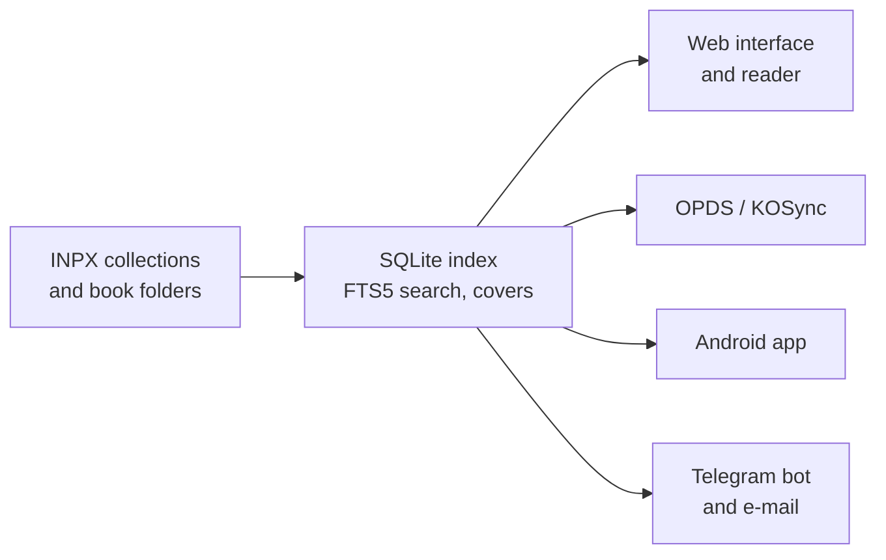

Metadata (series, authors, genres) comes from the index and is served through `/api/*` — one contract for the web, OPDS, Telegram and Android.

## Configuration

Almost everything is configured in the admin panel. Environment variables set the defaults; the full list with comments is in [`.env.example`](.env.example) (copy it to `.env`).

<details>
<summary><b>Main environment variables</b></summary>

| Variable | Default | Description |
|---|---|---|
| `PORT` | `3000` | Server port |
| `LIBRARY_ROOT` | `/library` | Default books folder |
| `SESSION_SECURE_COOKIE` | `false` | `true` behind HTTPS |
| `TRUST_PROXY` | `false` | Proxy in front of the server: `1` — a single nginx / Caddy, `loopback` or a list of subnets |
| `SMTP_HOST`, `SMTP_PORT`, `SMTP_USER`, `SMTP_PASS`, `SMTP_FROM` | — | Mail for sending to e-readers (or in the admin panel) |
| `TELEGRAM_BOT_TOKEN` | — | Telegram bot token (or in the admin panel) |
| `SCAN_INTERVAL_HOURS` | `0` | Rescan sources every N hours |
| `FOLDER_WATCH` | `1` | Watch folders and index new files |
| `DOWNLOAD_MAX_CONCURRENT` | `4` | How many books are prepared for download at once |
| `PERF_PROFILE` | auto | `embedded` for a NAS / low memory |
| `CLUSTER_WORKERS` | `0` | Number of processes (0 — one) |

</details>

<details>
<summary><b>Large libraries and low-end hardware</b></summary>

- Indexing and heavy recounts run in background threads — the server keeps responding during an import.
- On devices with ≤ 2 GB of RAM a lean profile is used; the database cache is set in **Admin → Dashboard → Maintenance → Database memory**.
- INPX builds with PPMd archives and WebP images are supported. For older e-readers, turn on **Admin → Content → Books with WebP images** (recode to PNG).
- Added a second copy of the same collection? Run **Admin → Duplicates → Auto-clean duplicates**.

</details>

<details>
<summary><b>Troubleshooting</b></summary>

- **The server doesn't respond:** `curl -sS http://127.0.0.1:3000/health` should return `"ok":true`.
- **The catalog is empty:** is the source added and has indexing finished? In Docker, the source path is inside the container (`/library`, `/sources/…`).
- **«Archives not found» after an INPX import:** the `.zip` / `.7z` archives must sit next to the `.inpx`; check the mount.
- **No EPUB / MOBI under «Download»:** the converter is not installed — run `install.cmd` / `install.sh` again.
- **`better-sqlite3` / `NODE_MODULE_VERSION` error:** run `install.cmd` / `install.sh` again.
- **Forgot the admin password:** `reset-admin.cmd` (Windows) or `./reset-admin.sh`.
- **The server «freezes»:** look for `[perf] event loop stalled` in `data/runtime.log`; response times are at `/health/perf`.

</details>

## For developers

```bash
npm install
npm run dev      # restarts on changes
npm test
```

Node.js (ESM), Express, SQLite (better-sqlite3), vanilla JS / CSS without frameworks. Documentation (mostly in English): [`AGENTS.md`](AGENTS.md) (API for Android and project rules), [`docs/architecture`](docs/architecture) (indexing, INPX, search, OPDS), [`docs/decisions`](docs/decisions). API errors carry a stable `code` field — clients should rely on it. Issues and pull requests in English are welcome.

## Related projects

| Repository | |
|---|---|
| [inpx-library-server](https://github.com/Habsaec/inpx-library-server) | Server: index, web, OPDS, API (this repository) |
| [inpx-book-reader](https://github.com/Habsaec/inpx-book-reader) | Android app |

## License

[MIT](LICENSE)
